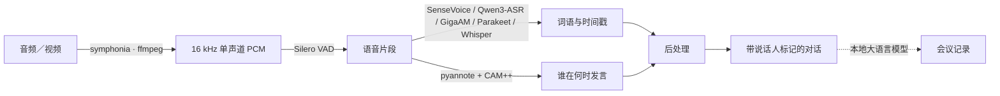

<div align="center">

<a href="README.md">Русский</a> · <a href="README.en.md">English</a> · <a href="README.zh-CN.md"><b>简体中文</b></a>


<h3>区分说话人的语音转写 · 语音输入 · 本地 MCP 服务器 — 支持完全离线运行</h3>

<p>
一款桌面应用，集成三种工具：带说话人标记和 AI 纪要的<b>语音转写</b>、适用于任意应用的<b>语音输入</b>，以及供 AI 代理调用的<b>本地 MCP 服务器</b>。本地模式下，所有处理均在本机完成；选择云端 AI 时，相关转写文本会发送至您配置的服务商。
</p>

<p><b>免费 · 无需账号或注册 · 支持完全本地运行</b></p>

<p>
<a href="../../releases/latest"></a>
<a href="../../actions/workflows/ci.yml"></a>


</p>

<h3>下载最新版本</h3>

<p>
<a href="../../releases/latest/download/SpeakAgent-Windows-Setup.exe"></a>
&nbsp;
<a href="../../releases/latest/download/SpeakAgent-macOS-Apple-Silicon.dmg"></a>
&nbsp;
<a href="../../releases/latest/download/SpeakAgent-macOS-Intel.dmg"></a>
</p>

<p><sub>直接下载最新版本。不确定 Mac 的芯片类型？打开苹果菜单 →“关于本机”：显示“Apple M…”即为 Apple Silicon，显示“Intel”即为 Intel。首次启动与 Gatekeeper 的处理方式见<a href="#-安装">安装</a>。</sub></p>

</div>

---

## 目录

[三种工具](#-三种工具集于一身) ·
[功能](#-功能) ·
[截图](#-截图) ·
[工作原理](#️-工作原理) ·
[模型](#-模型) ·
[性能](#-性能) ·
[安装](#-安装) ·
[技术栈](#-技术栈) ·
[路线图](#️-路线图) ·
[许可证](#-许可证)

## 🎯 三种工具集于一身

**🎧 录音转写。** 将会议、采访、讲座或语音留言转换为清晰的文本，标明“谁说了什么”，并生成 **AI 会议记录**（摘要、纪要、待办任务）。提供同步高亮播放器、TXT/MD/PDF 导出和可搜索的历史记录。

**🎙️ 语音输入。** 在任意应用中使用全局快捷键：按住、说话、松开，即可在本地识别并将文字粘贴到光标位置。类似 superwhisper，支持离线且免费。

**🔌 本地 MCP 服务器。** AI 或编程代理（Claude Code、Cursor、VS Code、Codex）可以通过 Model Context Protocol 在您的电脑上调用转写与说话人分离引擎，完成文件转写、说话人分离、纪要生成和历史查询。

> 三种功能均支持**完全离线**运行，适用于不同硬件，无需订阅或账号。如果主动选择云端 AI，相关文本会发送至您配置的服务商。

**界面语言：** 支持简体中文、俄语和英语，默认使用简体中文；已保存的语言选择会保留。可在“设置 → 界面语言”中切换，会议总结和自动标题也使用所选语言。中文语音识别默认使用 SenseVoiceSmall，质量优先可选择 Qwen3-ASR 0.6B；GigaAM 面向俄语识别，界面语言与识别模型可分别选择。

## ✨ 功能

**适用人群：** 记者、研究人员、学生、律师、医护人员、人力资源工作者，以及希望在保护隐私的前提下，将采访、讲座、会议或语音留言转换为文字的人。

| 功能 | 说明 |
|---|---|
| 🔒 **支持完全离线运行** | 转写、说话人分离和本地 AI 纪要均可在本机运行，适合采访、谈判及医疗、法律、人力资源等录音场景。云端 AI 为可选功能，启用后会将相关转写文本发送至所配置的服务商。 |
| 🗣️ **识别谁在何时发言** | 自动按说话人分段，例如“说话人 1 [00:14]：…”。可指定准确人数，也可自动检测。 |
| 📝 **会议记录** | 本地大语言模型可将转写整理为摘要、会议纪要、面试纪要或任务清单，支持交互式复选框。 |
| 💻 **低配置硬件也可运行** | 优先支持处理器运行：即使单核也可达到约 7 倍实时速度（每小时音频约需 17 分钟），内存峰值低于 1 GB，无需显卡。 |
| 🌍 **模型与语言选择** | 界面默认简体中文，并支持俄语和英语。中文默认 SenseVoiceSmall，可选 Qwen3-ASR 0.6B、Whisper、俄语 GigaAM 和欧洲语言 Parakeet（不支持中文）。 |
| 🎧 **同步高亮播放器** | 内置音视频播放器会高亮当前发言，点击发言即可跳转播放。 |
| ✏️ **说话人重命名** | 将“说话人 1”改为真实姓名；名称会保存并注入大语言模型提示词，让纪要使用姓名而非通用编号。 |
| 📄 **导出 TXT / MD / PDF** | 导出转写与会议记录；PDF 使用原生生成方式，内嵌支持简体中文、西里尔字母和拉丁字母的字体。 |
| 🕘 **录音历史** | 结果存储于本地 SQLite 数据库，下次启动自动恢复，可根据会议内容自动生成标题。 |
| ⚡ **会议记录显卡加速** | 支持 Vulkan 的独立显卡（显存至少 4 GB）可自动将大语言模型加速约 10 倍；集成显卡或不支持 Vulkan 时自动回退到处理器。 |
| 📥 **下载大小清晰可见** | 首次启动向导和后台下载均显示实际大小，小型模型内置于安装包。 |
| 🖱️ **拖放、取消与预计时间** | 支持文件拖放、停止处理、自动校准的预计时间，以及显示处理器和内存负载的实时状态栏。 |
| 🎙️ **语音输入（按住说话）** | 全局快捷键支持单个按键，例如右 Shift：按住说话，松开后在本地识别、复制到剪贴板并粘贴到任意应用的光标位置。语音输入历史显示在独立页面。 |
| 🔌 **本地 MCP 服务器** | 内置运行于 `127.0.0.1` 的 Model Context Protocol 服务器，AI 或编程代理（Claude Code、Cursor、VS Code、Codex）可调用引擎转写、分离说话人、生成纪要并查看历史。提供快速添加客户端的入口。 |
| 🖥️ **托盘与后台运行** | 可最小化到系统托盘，关闭窗口不会中止处理或 MCP 服务器。 |
| ⬆️ **自动更新** | 在“关于 → 检查更新”中查找新的 GitHub 版本，并下载、安装签名更新。 |

## 🎬 截图

<p align="center">
  
</p>
<p align="center"><sub>带说话人标记的转写：当前发言与播放器同步高亮，点击发言即可跳转播放。</sub></p>

<table>
  <tr>
    <td width="50%" align="center"><br><sub>首页</sub></td>
    <td width="50%" align="center"><br><sub>语音输入（按住说话）</sub></td>
  </tr>
  <tr>
    <td align="center"><br><sub>本地 MCP 服务器</sub></td>
    <td align="center"><br><sub>关于与自动更新</sub></td>
  </tr>
</table>

截图展示原有版本；当前应用已支持简体中文界面。

## ⚙️ 工作原理

统一的原生处理流水线，在本机完成：



1. **解码** — 将音视频解码为 16 kHz 单声道 PCM：优先使用原生 `symphonia`；webm/opus 及其他不支持的格式回退到 `ffmpeg`。
2. **语音切片（VAD）** — Silero VAD 将长文件切分为不超过 20 秒的片段，使边界位于静音处，避免从词语中间截断。
3. **语音识别（ASR）** — 每个片段经 sherpa-onnx（SenseVoice / Qwen3-ASR / GigaAM CTC / Parakeet / Whisper）处理，输出词语和时间戳；GigaAM v3 可直接输出标点与大小写。
4. **说话人分离** — pyannote-segmentation 与 CAM++ 声纹嵌入模型识别“谁在何时发言”，支持聚类阈值或界面指定的准确人数。
5. **后处理** — 按最大时间重叠将词语分配给说话人，平滑孤立片段并合并相邻发言，得到“说话人 N [时间戳]：文本”。
6. **会议记录**（可选）— 通过 `llama-server` 将转写传给本地大语言模型，生成摘要、纪要和任务。长录音使用 map-reduce 并缓存分段摘要，同一会议的第二种结果生成成本约降至九分之一。也可在设置中连接云端 AI；此时相关文本会发送至所配置的服务商。

## 🧠 模型

识别模型在设置中选择，说话人分离辅助模型在后台下载。模型会在**首次需要时下载**，不包含于本代码仓库。界面语言与识别语言独立；中文默认 SenseVoiceSmall，质量优先可对比 Qwen3-ASR 0.6B。中文识别与 Rust CUDA 配置详见 [CHINESE_ASR.md](CHINESE_ASR.md)。

| 模型 | 用途 | 大小 | 许可证 |
|---|---|---:|---|
| **GigaAM v3 CTC-punct** | 俄语识别，支持标点和词级时间戳 | 约 160 MB | ⚠️ 仅限非商业用途 |
| **Parakeet-TDT-0.6b-v3** | 语音识别，25 种欧洲语言（不含中文） | 约 640 MB | CC-BY-4.0 |
| **SenseVoiceSmall INT8** | 中文快速识别（默认）、粤语等 5 种语言 | 约 238 MB | FunASR 模型许可 |
| **Qwen3-ASR 0.6B INT8** | 中文质量优先、30 种语言及 22 种中文方言 | 约 987 MB | Apache-2.0 |
| **Whisper small** | 语音识别，98 种语言，可用于多语言对比 | 约 466 MB | MIT |
| **Whisper large-v3 turbo** | 语音识别，99 种语言，适合复杂音频及中文 | 约 540 MB | MIT |
| **Qwen3-4B-Instruct-2507**（Q4_K_M） | 大语言模型会议记录，质量优先 | 约 2.4 GB | Apache-2.0 |
| **Qwen3-1.7B**（Q4_K_M） | 大语言模型会议记录，适合低配置电脑 | 约 1.1 GB | Apache-2.0 |
| pyannote-segmentation-3.0 | 说话人分离中的语音分段 | 约 6 MB | MIT |
| CAM++（3D-Speaker） | 说话人分离中的声纹嵌入 | 约 28 MB | Apache-2.0 |
| Silero VAD | 语音活动检测 | 约 2 MB | MIT |

> ⚠️ **GigaAM** 模型采用非商业许可证。完整组件许可见 [`NOTICE.md`](NOTICE.md)。

## 📊 性能

下列历史数据来自处理器测试（阶段 0 与真实会议）。语音识别现可选 Rust CUDA 推理，会议记录使用独立的 Vulkan 加速路径。本机 GTX 1050 的 INT8 识别实测中 CUDA 更慢；新中文模型的测试结果和配置见 [CHINESE_ASR.md](CHINESE_ASR.md)。

| 指标 | 数值 |
|---|---|
| GigaAM（俄语），处理器 | 实时速度的 **15.9 倍** |
| Parakeet-v3，处理器 | 实时速度的 24 倍 |
| Whisper-small，处理器 | 实时速度的 2.7 倍 |
| 说话人分离，处理器 | 实时速度的 14 倍 |
| 1 小时音频：识别与说话人分离 | 约 8–9 分钟（多核处理器） |
| 单核运行 | 实时速度的 7 倍（每小时音频约需 17 分钟） |
| 内存峰值 | **低于 1 GB**，不随录音长度增长 |
| 安装包／发布版 exe | 约 8 MB／32 MB |
| 处理器生成会议记录（服务已预热） | 摘要约 33 秒 |
| 显卡生成会议记录（Vulkan，RTX 3090 Ti） | 约 169 token/秒，约为处理器的 10 倍 |

## 🚀 安装

### 使用预构建安装包

从 [**Releases**](../../releases) 下载最新安装包：

- **macOS Apple Silicon（M1 及以后）** — `*_aarch64.dmg`；
- **macOS Intel** — `*_x64.dmg`；
- **Windows 10/11** — `*-setup.exe`（NSIS）。

安装后应用支持**自动更新**：“关于 → 检查更新”（或打开页面时的静默检查）会查找新的 GitHub 发布版本并安装。

> **首次启动**（应用尚未使用付费 Apple/Microsoft 证书签名）：
>
> - **macOS** — 将应用拖到“应用程序”，然后**右键应用 →“打开”→“打开”**。若 macOS 提示“已损坏”，执行一次以下命令清除隔离标记：
>   `xattr -cr /Applications/SpeakAgent.app`
> - **Windows** — 在 SmartScreen 提示中点击“更多信息”→“仍要运行”。
>
> 后续可通过应用内更新功能升级。

### 从源码构建

**依赖：** [Rust](https://rustup.rs/)（`stable-x86_64-pc-windows-msvc`）、**MSVC C++ Build Tools**（链接器与 Windows SDK）、[Node 20](https://nodejs.org/) 和 [pnpm](https://pnpm.io/)。FFmpeg 会自动下载，无需系统安装。

```bash
pnpm install
pnpm tauri dev                       # 启动应用（Vite 与原生窗口）
pnpm tauri build --bundles nsis      # 安装包 → src-tauri/target/release/bundle/nsis/*.exe
```

如果缺少 MSVC Build Tools，在管理员终端运行：

```powershell
winget install --id Microsoft.VisualStudio.2022.BuildTools --override "--quiet --wait --add Microsoft.VisualStudio.Workload.VCTools --includeRecommended"
```

**无界面引擎快速测试**（不启动 GUI，验证 Rust 核心）：

```bash
cd src-tauri
cargo run --example try_transcribe -- "<file>" [secs] [diarize]
cargo run --example try_llm -- gen <transcript.txt> [summary|business|interview|todo]
```

### 参与贡献

欢迎提交 issue 和 pull request。Windows 与 macOS 的构建方法、代码风格、发布流程及维护者所需的密钥配置说明见 [**`CONTRIBUTING.md`**](CONTRIBUTING.md)。

> 这是开发者利用业余时间维护的非商业项目。回复可能较慢，不承诺提供支持，应用按现状提供。

## 🛠 技术栈

- **桌面外壳：** Tauri 2（Rust 核心与系统 WebView）。安装包约 8 MB；发布版 exe 约 32 MB，静态链接 sherpa-onnx 和 ONNX Runtime，无需额外 DLL。
- **前端：** React 19 · Vite 7 · Tailwind 4 · Zustand · TanStack Query · react-router。深灰与琥珀色主题，采用玻璃效果和窗口透明效果。
- **引擎：** [sherpa-onnx](https://github.com/k2-fsa/sherpa-onnx) 1.13.4（官方 Rust crate，使用预构建二进制，无需编译 C++），实现语音识别、说话人分离和 Silero VAD。
- **本地大语言模型：** `llama-server`（llama.cpp）作为伴随进程，像 ffmpeg 一样在运行时下载；Vulkan 构建在同一压缩包中支持显卡与处理器；通过 `ureq` 调用兼容 OpenAI 的 HTTP 流式接口。
- **解码：** `symphonia`（纯 Rust）与 `ffmpeg` 回退方案。**存储：** SQLite（`rusqlite`）。**PDF：** `genpdf` 与内嵌 DejaVu 字体。

## 🗺️ 路线图

| 阶段 | 范围 | 状态 |
|---|---|---|
| 0 | 使用真实文件验证核心（sherpa-onnx） | ✅ 已完成 |
| 1 | Windows MVP：转写、说话人分离、模型、导出、历史、播放器 | ✅ 已完成 |
| 2 | macOS（Intel 与 Apple Silicon）与 Metal：`.app`/`.dmg`、窗口透明效果 | ✅ 已完成 |
| 3 | 本地大语言模型生成会议记录：纪要、摘要、任务 | ✅ 已完成 |
| — | 语音输入（按住说话）、本地 MCP 服务器、托盘 | ✅ 已完成 |
| — | 自动更新（GitHub Releases 与签名更新） | ✅ 已完成 |
| — | 简体中文／俄语／英语界面、对应语言的会议记录提示词，默认简体中文 | ✅ 已完成 |
| — | 编辑说话人（合并、重新分配）与可选大语言模型文本整理 | ✅ 已完成 |
| 4 | **代码签名（Apple Developer ID）与公证**：解决更新后的语音输入权限重置，以及 Gatekeeper/SmartScreen 提示 | ⬜ 进行中 |
| 5+ | 说话人分离优化、文件夹监控、字幕编辑器、术语表、实时流式处理 | ⬜ 计划中 |

> 项目仍处于早期（0.x）：核心功能与主要流程已在 Windows 和 macOS 上运行，但尚未使用付费证书签名，系统可能在首次启动时提示警告（处理方法见[安装](#-安装)）。项目将**持续免费**，通过[捐助](#-支持项目)支持开发。

完整历史见 [`CHANGELOG.md`](CHANGELOG.md)。

## 📄 许可证

应用代码采用开源 [**Apache 2.0**](LICENSE.md) 许可证，可免费使用、修改和再分发，也可用于商业项目。**但俄语模型 GigaAM 仅限非商业用途**；使用该模型时，请遵守其个人、教育和非商业使用限制。商业使用请选择许可允许的模型（Parakeet — CC-BY-4.0，Whisper — MIT）。全部组件与模型许可见 [`NOTICE.md`](NOTICE.md)。

## 💛 支持项目

应用免费，支持离线运行，无需订阅。如果它对您有帮助，欢迎支持开发。捐助不提供额外技术支持或优先待遇，仅用于维持项目。

- **[Boosty](https://boosty.to/utekov)** — 单次或订阅捐助
- **Bitcoin（BTC）：** `bc1qakjpcjwxkttxs9d3qlgp42dpacngzry2qurhfp`
- **TON（GRAM）：** `UQC2KkNMTefPUJEjGr0mMik2nNgOkP_NT-_qnmaBrZTHJ0LP`

## 🙏 致谢

本项目基于以下开源组件构建，感谢各位作者：
[sherpa-onnx](https://github.com/k2-fsa/sherpa-onnx)、
[llama.cpp](https://github.com/ggml-org/llama.cpp)、
[GigaAM](https://github.com/salute-developers/GigaAM)、
[Whisper](https://github.com/openai/whisper)、
[NVIDIA NeMo Parakeet](https://huggingface.co/nvidia/parakeet-tdt-0.6b-v3)、
[pyannote](https://github.com/pyannote/pyannote-audio)、
[Silero VAD](https://github.com/snakers4/silero-vad)、
[Tauri](https://github.com/tauri-apps/tauri)。

<div align="center">
<sub>为重视录音隐私的您用心打造 ❤️。</sub>
</div>

